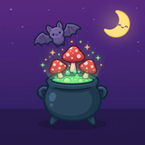
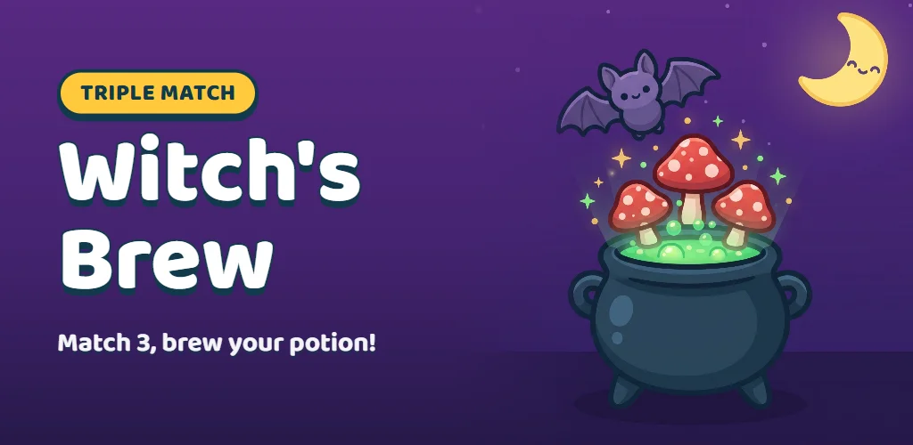
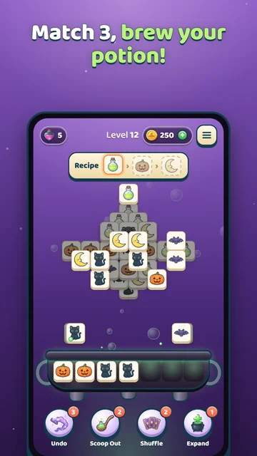
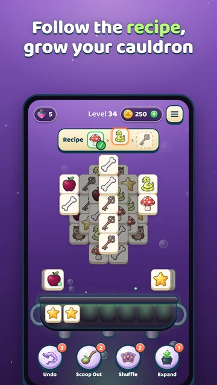
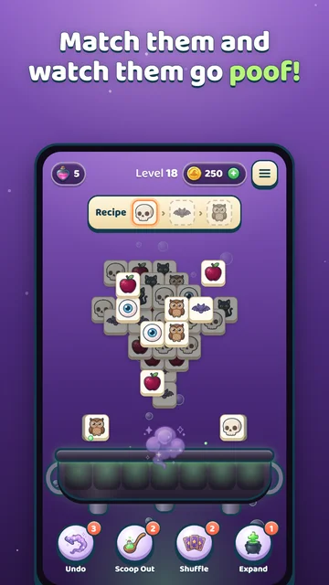
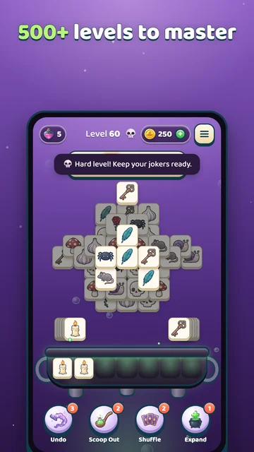

  

<h1 align="center">Triple Match – Witch's Brew</h1>

  A cozy triple-match puzzle game: match three ingredients, follow potion recipes and keep the cauldron from overflowing. 
  <b>Developed by <a href="https://omnipopgames.com">Omnipop Games</a></b>

  

  
  
  
  

## About

- 500+ levels with potion recipes and a 7-slot cauldron
- 4 magic boosters, 48 ingredients, music-box soundtrack
- Turkish and English
- Android (Google Play) — iOS coming soon

**Get it on Google Play:** [play.google.com](https://play.google.com/store/apps/details?id=com.omnipopgames.witchbrew) · **Website:** [omnipopgames.com](https://omnipopgames.com)

## Tech

HTML5 / JavaScript game packaged with Capacitor for Android and iOS, AdMob (with Google UMP consent) and in-app purchases via RevenueCat.

## Source code

This repository is a **public showcase only**. The game's source code is proprietary and kept in a private repository.

---

### Türkçe

**Üçlü Eşleştirme – Cadı Kazanı**: Üç malzemeyi eşleştir, iksir tariflerini tamamla ve kazanın taşmasına izin verme. [Omnipop Games](https://omnipopgames.com) tarafından geliştirildi. Bu depo yalnızca tanıtım amaçlıdır; oyunun kaynak kodu gizli tutulmaktadır.

---

© 2026 OMNİ MDC Teknoloji Sanayi ve Ticaret A.Ş. (Omnipop Games). All rights reserved.
"Triple Match – Witch's Brew", its artwork, characters and code may not be copied, modified, distributed or republished without written permission. See [LICENSE](LICENSE).
